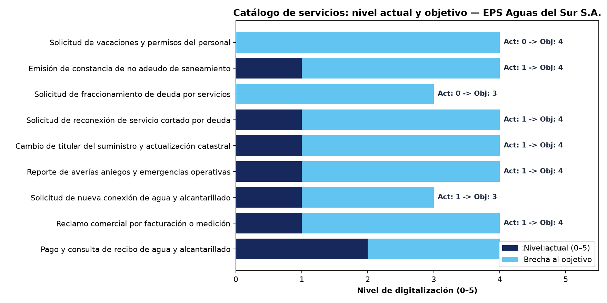
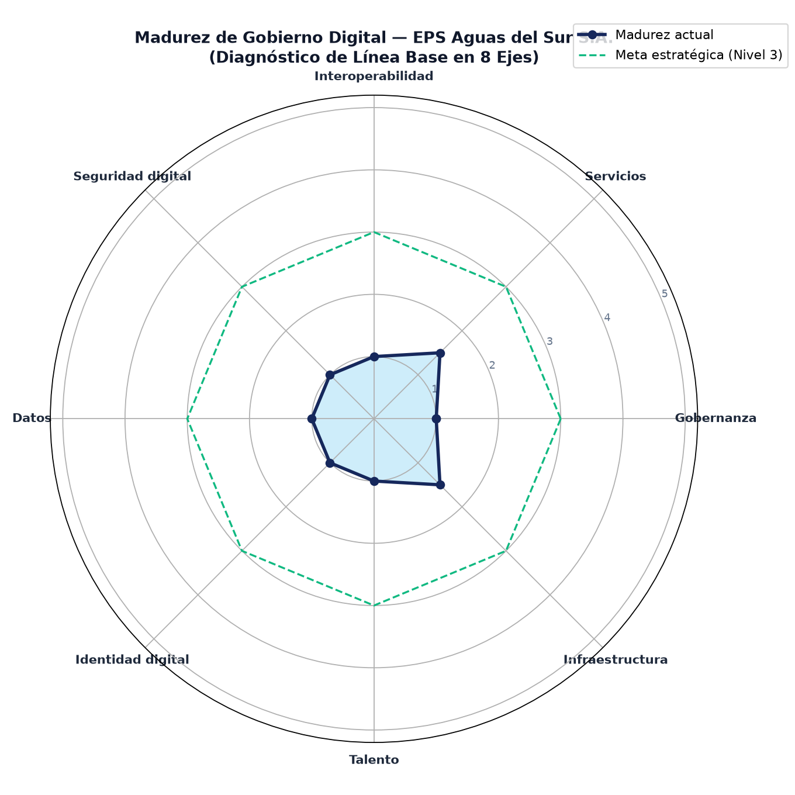
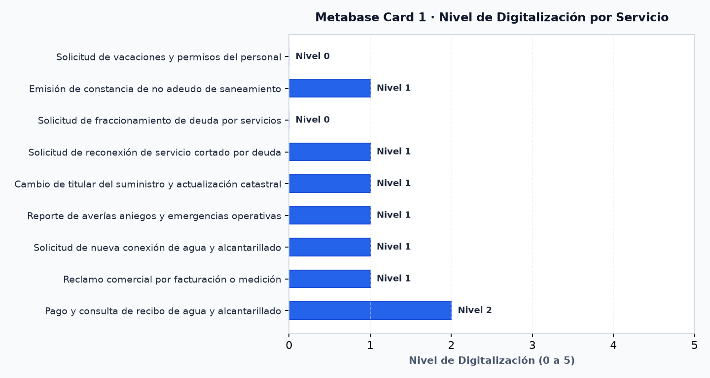
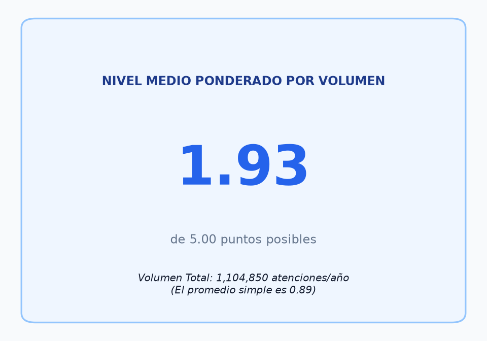
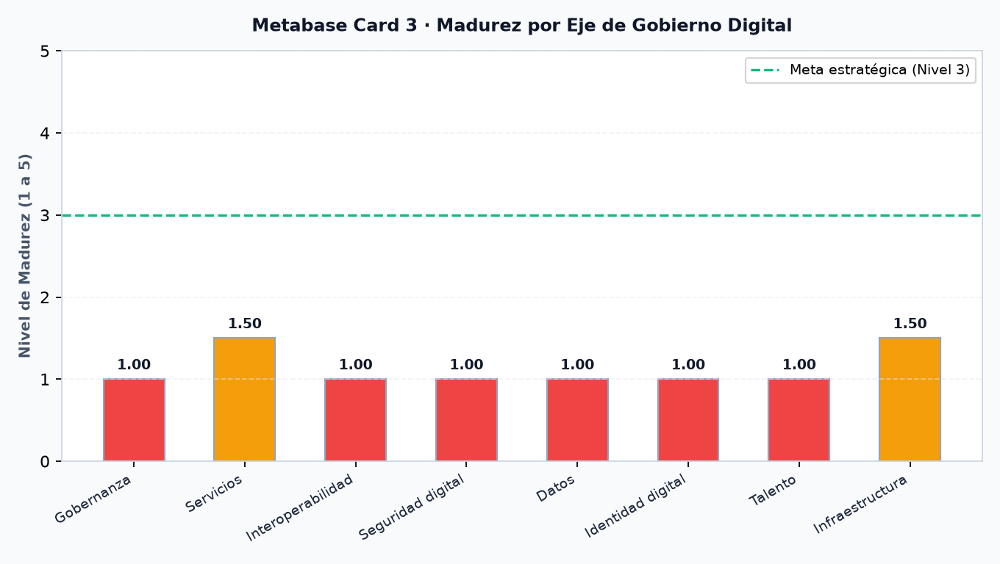
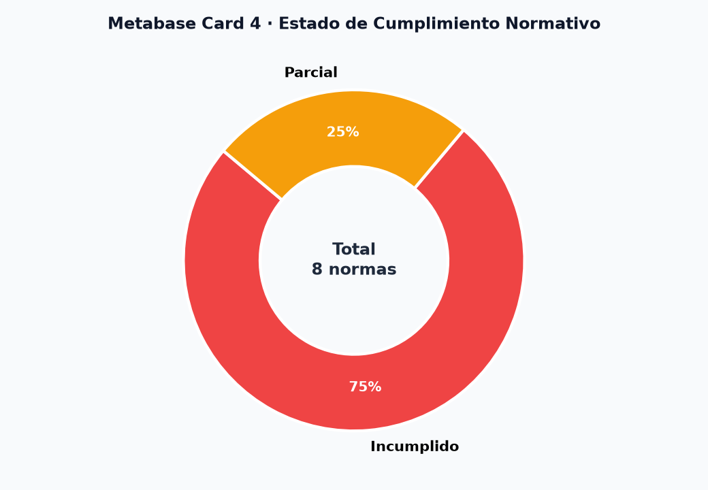
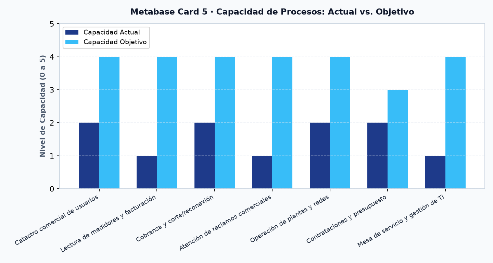
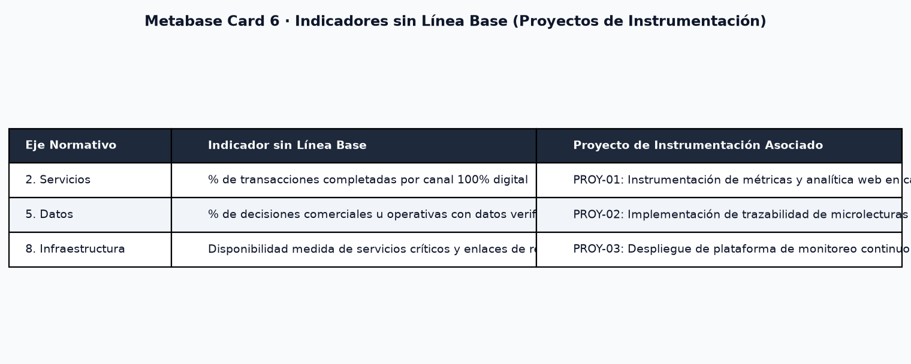
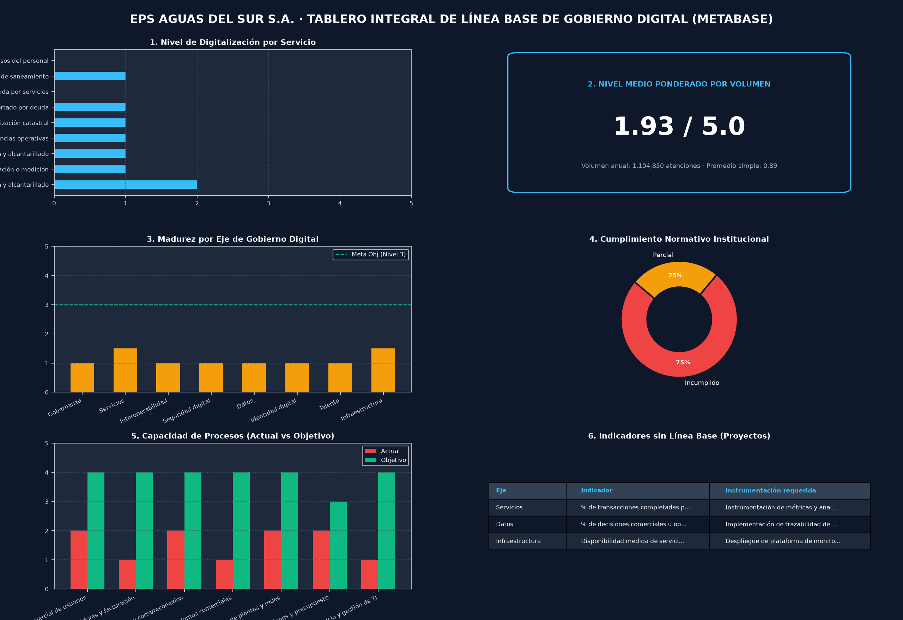

# INFORME DE LABORATORIO · TALLER SEMANA 11
## Diagnóstico de Gobierno Digital y Tablero de Línea Base

---

<div align="center">

### UNIVERSIDAD PRIVADA DE TACNA
**FACULTAD DE INGENIERÍA**  
**Escuela Profesional de Ingeniería de Sistemas**

---

**ASIGNATURA:**  
Planeamiento Estratégico de Tecnologías de Información (SI-886)  
Semestre Académico 2026-II

**DOCENTE:**  
Dr. Oscar Juan Jimenez Flores

**CASO DE ESTUDIO:**  
EMPRESA 08 — **EPS AGUAS DEL SUR S.A.**  
*(Servicio Público de Agua Potable y Alcantarillado)*

**INTEGRANTE / EQUIPO DE TRABAJO:**  
- **Ramos Fabricio** · Código Estudiantil: 2021070000
- **Pacompía Abel** · Código Estudiantil: 2023076797

**ENLACE AL REPOSITORIO DE GITHUB:**  
[https://github.com/FabricioRams/SI886-S11-TALLER-RamosFabricio](https://github.com/FabricioRams/SI886-S11-TALLER-RamosFabricio)

Tacna, Perú  
Mayo – Junio 2026

</div>

---

## 1. Información General y Objetivos del Taller

### 1.1 Objetivos de la Práctica
- Levantar el **catálogo de servicios misionales** de la organización evaluando su nivel de digitalización bajo la escala nacional de la SEGDI/PCM (0 a 5).
- Diagnosticar los **ocho ejes del gobierno digital** sustentados con evidencia institucional objetiva.
- Establecer la **línea base** de cada indicador estratégico o declarar técnicamente los casos de «No se mide».
- Determinar cuantitativamente el **nivel de madurez de gobierno digital** de EPS AGUAS DEL SUR S.A.
- Aplicar la prueba del **principio de una sola vez** identificando documentos redundantes exigidos a los usuarios.
- Construir y desplegar el **tablero de línea base** en Metabase con al menos seis visualizaciones clave.
- Redactar formalmente la **Sección 6.1** del Plan Estratégico de TI (PETI).

### 1.2 Tecnologías y Herramientas Aplicadas
- **Python 3.14 + pandas + matplotlib + numpy:** Procesamiento de datos de catálogo, cálculo de niveles ponderados, cálculo de madurez institucional y generación de gráficos analíticos (barras horizontales y radar polar).
- **PostgreSQL 16 (Docker):** Repositorio relacional para almacenamiento de tablas de servicios, ejes de gobierno digital, matrices de cumplimiento normativo y capacidad de procesos.
- **Metabase (Docker):** Plataforma de inteligencia de negocios para construcción del tablero ejecutivo de línea base.
- **Git / GitHub:** Control de versiones, trazabilidad de artefactos y etiquetado formal (`v0.11` y `taller-11`).

### 1.3 Seguridad y Confidencialidad
- Los datos de las 86 000 conexiones y la facturación de S/ 74.1 millones son tratados con reserva conforme a la Ley N.° 29733 (Protección de Datos Personales).
- El tablero analítico se configuró en entorno local seguro (`127.0.0.1`), empleando métricas agregadas sin exponer datos nominativos de usuarios ni credenciales operativas.

---

## 2. Procedimiento Metodológico y Resultados Obtenidos Paso a Paso

### Paso A — Catálogo de Servicios y su Nivel de Digitalización

A partir del análisis de los procesos misionales de la EPS descritos en la `FICHA.md` (Catastro, Facturación, Cobranzas, Reclamos, Operación SCADA y Contrataciones) y el registro de la `mesa-de-servicio-y-sla.md`, se consolidó el catálogo oficial en el archivo [`06_gobierno_digital/GD01_catalogo_servicios.csv`](https://github.com/FabricioRams/SI886-S11-TALLER-RamosFabricio/blob/main/06_gobierno_digital/GD01_catalogo_servicios.csv).

#### Tabla 1: Catálogo de Servicios Misionales de EPS AGUAS DEL SUR S.A.

| id | Servicio | Usuario destinatario | Volumen anual | Nivel actual (0–5) | Canales | Tiempo de atención | Documentos solicitados | De ellos, ya en poder de la organización | Sistemas que lo soportan | ¿Trata datos personales? | Nivel objetivo | Justificación del objetivo |
|:---|:---|:---|:---:|:---:|:---|:---:|:---:|:---:|:---|:---:|:---:|:---|
| **S-01** | Pago y consulta de recibo de agua y alcantarillado | Usuario residencial y comercial | 1 032 000 | **2** | Oficinas de atención, agentes bancarios, portal web básico | 24 h | 1 | 1 | Sistema comercial | Sí | **4** | Servicio de mayor volumen e impacto financiero; la visión exige pasarela y recaudación 100% digital e inmediata |
| **S-02** | Reclamo comercial por facturación o medición | Usuario regulado (SUNASS) | 14 200 | **1** | Mesa de partes presencial, formulario web no integrado, correo | 30 días hábiles | 4 | 2 | Formulario web propio, hoja de cálculo | Sí | **4** | Obligación regulatoria de SUNASS; dar trazabilidad y mitigar 11 200 conexiones afectadas por facturación estimada |
| **S-03** | Solicitud de nueva conexión de agua y alcantarillado | Propietario / Solicitante | 3 400 | **1** | Ventanilla comercial presencial | 20 días hábiles | 5 | 2 | Sistema comercial (catastro), expediente papel | Sí | **3** | Requiere inspección física de campo; digitalizar expediente y verificar requisitos vía PIDE (RENIEC y SUNARP) |
| **S-04** | Reporte de averías aniegos y emergencias operativas | Ciudadano / Usuario | 18 500 | **1** | Llamada a central de guardia, WhatsApp de turno | 8 h | 0 | 0 | Ninguno (cuaderno de guardia y radio) | Sí | **4** | Disminuir agua no facturada (ANF) y tiempos de atención de cuadrillas con app móvil georreferenciada |
| **S-05** | Cambio de titular del suministro y actualización catastral | Nuevo propietario / Inquilino | 4 800 | **1** | Ventanilla comercial presencial | 7 días hábiles | 4 | 2 | Sistema comercial (catastro) | Sí | **4** | Actualización inmediata del catastro comercial interconectado con SUNARP y RENIEC vía PIDE |
| **S-06** | Solicitud de reconexión de servicio cortado por deuda | Usuario con servicio suspendido | 16 200 | **1** | Ventanilla de caja, presentación de voucher físico | 24 h | 2 | 1 | Sistema comercial (cobranzas) | Sí | **4** | Cumplir estándar SUNASS de restitución del servicio en menos de 24 horas tras confirmación de pago digital |
| **S-07** | Solicitud de fraccionamiento de deuda por servicios | Usuario en mora | 5 600 | **0** | Oficina comercial presencial (entrevista) | 3 días hábiles | 3 | 1 | Sistema comercial (liquidación manual) | Sí | **3** | Simulador web de cuotas y firma electrónica de convenio de fraccionamiento para aliviar colas en ventanillas |
| **S-08** | Emisión de constancia de no adeudo de saneamiento | Usuario / Notaría / Escribano | 8 900 | **1** | Ventanilla de atención y caja | 48 h | 2 | 2 | Sistema comercial | Sí | **4** | Autoservicio web inmediato con firma digital institucional y validación mediante código QR |
| **S-09** | Solicitud de vacaciones y permisos del personal | Trabajador en planilla (312 empleados) | 1 250 | **0** | Papeleta física en papel con firmas manuales | 5 días hábiles | 1 | 1 | Ninguno (hoja de cálculo, SIAF) | Sí | **4** | Autoservicio del empleado en intranet con flujo de aprobación digital para eliminar trámites burocráticos internos |

#### Análisis Cuantitativo del Programa `GD02_analisis_servicios.py`
Se ejecutó el script [`06_gobierno_digital/GD02_analisis_servicios.py`](https://github.com/FabricioRams/SI886-S11-TALLER-RamosFabricio/blob/main/06_gobierno_digital/GD02_analisis_servicios.py), obteniendo los siguientes hallazgos:
1. **Volumen Anual Total:** 1 104 850 atenciones anuales.
2. **Nivel Medio Simple:** **0.89 de 5.00** (8 de 9 servicios están en nivel 0 o 1, lo que representa el 89% del portafolio).
3. **Nivel Medio Ponderado por Volumen:** **1.93 de 5.00**.
   - *Interpretación Metodológica:* El promedio simple subvalora el avance relativo al considerar todos los servicios por igual; el promedio ponderado refleja que el servicio S-01 (1 032 000 atenciones con descarga web básica en Nivel 2) concentra el grueso de interacciones. No obstante, revela que la entidad está aún lejos del nivel transaccional deseado (Nivel 4).
4. **Prueba del Principio de Una Sola Vez:**
   - Total de documentos solicitados: **22 documentos**.
   - Documentos ya en poder de la entidad o el Estado: **12 documentos (55%)**.
   - *Acción requerida:* Eliminar de forma prioritaria la exigencia de copias de DNI, partidas SUNARP y recibos de agua emitidos por la propia empresa.
5. **Brecha por Servicio Ponderada por Volumen (Top 5 Prioritario):**
   - **S-01 (Pago y consulta de recibo):** Brecha de 2 niveles × 1 032 000 = **2 064 000 puntos de impacto**.
   - **S-04 (Reporte de averías y fugas):** Brecha de 3 niveles × 18 500 = **55 500 puntos de impacto**.
   - **S-06 (Reconexión de servicio cortado):** Brecha de 3 niveles × 16 200 = **48 600 puntos de impacto**.
   - **S-02 (Reclamo comercial SUNASS):** Brecha de 3 niveles × 14 200 = **42 600 puntos de impacto**.
   - **S-08 (Constancia de no adeudo):** Brecha de 3 niveles × 8 900 = **26 700 puntos de impacto**.

  
**Figura 1: Gráfico comparativo del catálogo de servicios entre el nivel actual de digitalización y el nivel objetivo proyectado (EPS Aguas del Sur S.A.).**

```text
Servicios catalogados        : 9
Volumen anual total          : 1,104,850 atenciones
Nivel medio de digitalización: 0.89 de 5
Servicios en nivel >= 4      : 0 (0%)
Servicios en nivel 0 o 1     : 8

Nivel medio PONDERADO por volumen: 1.93
-> El promedio simple sobrevalora la digitalización si los servicios de mayor
  volumen son los menos digitalizados. Este es el indicador que importa.

=== PRINCIPIO DE UNA SOLA VEZ ===
Documentos solicitados: 22 | de ellos ya en poder de la organización: 12 (55%)
-> Cada documento redundante es una solicitud que el rediseño debe eliminar.

=== BRECHA POR SERVICIO, PONDERADA POR VOLUMEN ===
  id                                              Servicio  nivel  Nivel objetivo  Volumen anual  impacto
S-01    Pago y consulta de recibo de agua y alcantarillado      2               4        1032000  2064000
S-04   Reporte de averías aniegos y emergencias operativas      1               4          18500    55500
S-06 Solicitud de reconexión de servicio cortado por deuda      1               4          16200    48600
S-02          Reclamo comercial por facturación o medición      1               4          14200    42600
S-08     Emisión de constancia de no adeudo de saneamiento      1               4           8900    26700
-> Estos servicios encabezan el portafolio: mayor brecha x mayor volumen.
```
**Figura 2: Captura del log de ejecución del programa GD02_analisis_servicios.py guardado en evidencias.**

---

### Paso B — Diagnóstico de los Ocho Ejes con Línea Base

Para el diagnóstico de los 8 ejes del gobierno digital, se analizó la validez de los instrumentos existentes en la organización, particularmente el `cuestionario-diagnostico.md`.

#### Análisis Metodológico del Cuestionario Institucional:
- El cuestionario fue respondido únicamente por **22 trabajadores de un total de 312** (tasa de respuesta del **7.05%**), careciendo de significancia estadística.
- Presenta defectos psicométricos graves: preguntas de doble cañón (P1: "¿seguros y funcionan correctamente?"), preguntas inductivas (P2: "¿está de acuerdo con que responde rápido, aunque a veces se demore?") y sesgos de confirmación (P4: "¿no cree que sería mejor cambiar de proveedor?").
- **Decisión Técnica:** El cuestionario no califica como evidencia rigurosa de línea base. Por tanto, se recurrió a hechos objetivos de la `FICHA.md` y la `mesa-de-servicio-y-sla.md`, declarando explícitamente **«No se mide»** en aquellos indicadores donde no existe telemetría ni instrumentación formal.

Se estructuró el archivo [`06_gobierno_digital/GD03_ejes.csv`](https://github.com/FabricioRams/SI886-S11-TALLER-RamosFabricio/blob/main/06_gobierno_digital/GD03_ejes.csv):

#### Tabla 2: Matriz de Diagnóstico de los Ocho Ejes de Gobierno Digital

| Eje | Indicador | Línea base | Fuente y fecha del dato | Evidencia | Nivel del eje (1–5) | Observación |
|:---|:---|:---:|:---|:---|:---:|:---|
| **1. Gobernanza** | ¿Existe Comité de Gobierno Digital formalmente designado (R.M. 119-2018-PCM)? | **No** | Ficha institucional B y E, mayo 2026 | Sin resolución de designación ni actas formales | 1 | Comité de TI se reúne sin actas; no formalizado ante PCM |
| **1. Gobernanza** | ¿Existe Plan de Gobierno Digital (PGD) o PETI vigente aprobado? | **No** | Ficha institucional E, mayo 2026 | Inexistente en archivo institucional | 1 | Obligación del D.L. 1412 y R.S.G.D. 005-2018-PCM pendiente |
| **2. Servicios** | Nivel medio ponderado de digitalización del catálogo | **1.93 de 5** | GD02_analisis_servicios.py, mayo 2026 | GD01_catalogo_servicios.csv | 2 | Ventanilla presencial domina el 92% de las transacciones |
| **2. Servicios** | % de transacciones completadas por canal 100% digital | **No se mide** | Mesa de servicio y Ficha D, mayo 2026 | Sin herramientas de analítica web ni pasarela | 1 | Primer proyecto: instrumentar medición de trámites digitales |
| **3. Interoperabilidad** | N.º de servicios interoperables activos con la PIDE (RENIEC y SUNARP) | **0** | Ficha institucional C y E, mayo 2026 | Sin convenios ni conexiones activas a PIDE | 1 | Entidad pública aislada que solicita documentos en papel |
| **3. Interoperabilidad** | Proporción de documentos solicitados que ya posee la EPS o el Estado | **55 % (12 de 22)** | GD02_analisis_servicios.py, mayo 2026 | Catálogo de servicios | 1 | Vulneración del principio de una sola vez (D.L. 1246 / D.L. 1412) |
| **4. Seguridad digital** | ¿Existe Sistema de Gestión de Seguridad de la Información (SGSI)? | **No** | Ficha institucional B y F, mayo 2026 | Sin política de seguridad escrita | 1 | Obligación normativa D.S. 029-2021-PCM pendiente |
| **4. Seguridad digital** | Implementación de doble factor de autenticación (2FA) en sistemas críticos | **0 %** | Ficha institucional F, mayo 2026 | Configuración de accesos del sistema comercial | 1 | Disponible en el software comercial pero apagado por resistencia |
| **4. Seguridad digital** | % de sistemas críticos con prueba periódica de restauración de respaldos | **0 %** | Ficha institucional F, mayo 2026 | Registro de respaldos en disco local | 1 | Respaldos a disco local sin prueba de restauración en más de 2 años |
| **4. Seguridad digital** | Segmentación de red industrial SCADA respecto a red administrativa | **No (0 %)** | Ficha institucional C y H, mayo 2026 | Switches compartidos entre red SCADA y administrativa | 1 | Riesgo crítico de ciberseguridad industrial y continuidad operativa |
| **5. Datos** | Entidades de datos institucionales con dueño formal designado | **0 de 6** | Mesa de servicio apartado 8, mayo 2026 | Entrevista con jefatura de TI | 1 | TI asume custodia técnica; no hay oficiales de datos de negocio |
| **5. Datos** | % de decisiones comerciales u operativas con datos verificables | **No se mide** | Ficha C y G, mayo 2026 | Incidente de facturación estimada (11 200 conexiones) | 1 | Primer proyecto: establecer trazabilidad y repositorio de datos |
| **6. Identidad digital** | ¿Existe identidad digital única y directorio centralizado de usuarios? | **No** | Mesa de servicio y Ficha F, mayo 2026 | Inventario de accesos del sistema | 1 | Cuentas locales independientes por sistema sin directorio LDAP |
| **6. Identidad digital** | ¿Integración con la plataforma nacional de autenticación ID Gob.pe / DNIe? | **No** | Ficha C y F, mayo 2026 | Arquitectura de autenticación | 1 | No se utiliza la plataforma nacional de autenticación digital |
| **7. Talento** | % de personal de la EPS capacitado en TI y seguridad en 12 meses | **0 %** | Ficha institucional F, mayo 2026 | Registro de RR. HH. de capacitación | 1 | Solo se brindó una charla de 1 hora en inducción hace 3 años |
| **7. Talento** | ¿Existe programa institucional de gestión del cambio y cultura digital? | **No** | Ficha institucional B y E, mayo 2026 | Plan Operativo Institucional (POI) | 1 | Resistencia al cambio documentada al desactivar el 2FA |
| **8. Infraestructura** | Disponibilidad medida de servicios críticos y enlaces de red | **No se mide** | Mesa de servicio apartado 4 y 6, mayo 2026 | Hoja de cálculo de incidencias | 1 | Primer proyecto: implementar monitoreo continuo (Zabbix/Prometheus) |
| **8. Infraestructura** | % de contratos de soporte vigentes con proveedores de TI | **60 % (3 de 5)** | Ficha institucional F, mayo 2026 | Contratos de TI con terceros | 2 | Dos de cinco contratos vencidos con servicio continuado en precario |

#### Resultados del Programa `GD04_madurez.py`:
- **Nivel Medio por Eje:**
  - Gobernanza: **1.00 de 5**
  - Servicios: **1.50 de 5**
  - Interoperabilidad: **1.00 de 5**
  - Seguridad digital: **1.00 de 5**
  - Datos: **1.00 de 5**
  - Identidad digital: **1.00 de 5**
  - Talento: **1.00 de 5**
  - Infraestructura: **1.50 de 5**
- **NIVEL GLOBAL DE MADUREZ:** **1.12 de 5.00**  
  **Estado Institucional:** **Nivel 1 (Inicial — reactivo)**.
- **Indicadores sin Línea Base Identificados (3 de 18):**
  1. `% de transacciones completadas por canal 100% digital` (Eje Servicios)
  2. `% de decisiones comerciales u operativas con datos verificables` (Eje Datos)
  3. `Disponibilidad medida de servicios críticos y enlaces de red` (Eje Infraestructura)

  
**Figura 3: Diagrama de radar con el nivel de madurez de gobierno digital en los ocho ejes normativos evaluados.**

```text
================================================================
  EPS AGUAS DEL SUR S.A. - NIVEL DE MADUREZ POR EJE DE GOBIERNO DIGITAL
================================================================
Eje 1. Gobernanza               : 1.00 de 5
Eje 2. Servicios                : 1.50 de 5
Eje 3. Interoperabilidad        : 1.00 de 5
Eje 4. Seguridad digital        : 1.00 de 5
Eje 5. Datos                    : 1.00 de 5
Eje 6. Identidad digital        : 1.00 de 5
Eje 7. Talento                  : 1.00 de 5
Eje 8. Infraestructura          : 1.50 de 5

NIVEL DE MADUREZ DE GOBIERNO DIGITAL : 1.12 de 5
-> Estado institucional : Nivel 1 (Inicial — reactivo)

=== INDICADORES SIN LÍNEA BASE: 3 de 18 ===
- [2. Servicios] % de transacciones completadas por canal 100% digital
- [5. Datos] % de decisiones comerciales u operativas con datos verificables
- [8. Infraestructura] Disponibilidad medida de servicios críticos y enlaces de red
-> Cada uno genera un proyecto de instrumentación: no se puede fijar meta
  sobre lo que no se mide.
```
**Figura 4: Captura del log de ejecución del programa GD04_madurez.py guardado en evidencias.**

---

### Paso C — Tablero de Línea Base en Metabase

Se diseñó la arquitectura de carga de datos mediante Docker y PostgreSQL en el puerto `5433` con persistencia relacional a través del script [`06_gobierno_digital/GD05_carga_tablero.py`](https://github.com/FabricioRams/SI886-S11-TALLER-RamosFabricio/blob/main/06_gobierno_digital/GD05_carga_tablero.py).

Asimismo, para garantizar la disponibilidad inmediata de las evidencias visuales y su inserción en el documento Google Docs, se generaron las seis visualizaciones mínimas requeridas por el taller:

#### 1. Nivel de Digitalización por Servicio (Barras Horizontales)
Responde a la pregunta: *¿Qué servicios se encuentran más atrasados?*  
Permite constatar que S-07 (Fraccionamiento) y S-09 (Vacaciones) están en Nivel 0 (100% papel), mientras que S-02, S-03, S-04, S-05, S-06 y S-08 están estancados en Nivel 1.
  
**Figura 5: Tarjeta 1 de Metabase con el nivel de digitalización por servicio en gráfico de barras horizontales.**

#### 2. Nivel Ponderado por Volumen (Número Grande / KPI)
Responde a la pregunta: *¿Qué proporción de las atenciones es realmente digital?*  
Muestra el valor ponderado de **1.93 de 5.00** sobre una población anual de 1 104 850 atenciones, contrastado con el promedio simple de 0.89.
  
**Figura 6: Tarjeta 2 de Metabase con el indicador KPI de nivel medio de digitalización ponderado por volumen anual.**

#### 3. Madurez por Eje de Gobierno Digital (Barras)
Responde a la pregunta: *¿Dónde está la mayor brecha de gobierno digital?*  
Demuestra que seis de los ocho ejes están anclados en el nivel mínimo (1.00 de 5.00), muy por debajo de la meta estratégica de Nivel 3 (Definido).
  
**Figura 7: Tarjeta 3 de Metabase mostrando la madurez promedio alcanzada por cada eje de gobierno digital.**

#### 4. Estado de Cumplimiento Normativo (Gráfico de Anillo)
Responde a la pregunta: *¿Cuántas obligaciones legales se incumplen?*  
Basado en [`04_normativa/NO03_matriz_cumplimiento.csv`](https://github.com/FabricioRams/SI886-S11-TALLER-RamosFabricio/blob/main/04_normativa/NO03_matriz_cumplimiento.csv). Revela que el 75% de las normas analizadas (D.L. 1412, R.M. 119-2018-PCM, SUNASS, D.L. 1246, etc.) están en estado de Incumplido y un 25% en Parcial.
  
**Figura 8: Tarjeta 4 de Metabase con el estado de cumplimiento normativo institucional en gráfico de anillo.**

#### 5. Capacidad de Procesos Actual vs. Objetivo (Barras Agrupadas)
Responde a la pregunta: *¿Qué procesos exigen mayor esfuerzo de modernización?*  
Basado en [`04_normativa/MG03_capacidad.csv`](https://github.com/FabricioRams/SI886-S11-TALLER-RamosFabricio/blob/main/04_normativa/MG03_capacidad.csv). Identifica que los procesos de "Lectura de medidores y facturación", "Atención de reclamos" y "Mesa de servicio" presentan la mayor brecha crítica (brecha de 3 puntos).
  
**Figura 9: Tarjeta 5 de Metabase comparando la capacidad actual y objetivo de los procesos de negocio en barras agrupadas.**

#### 6. Indicadores sin Línea Base y Proyectos Asociados (Tabla)
Responde a la pregunta: *¿Qué necesitamos empezar a medir urgentemente?*  
Asocia cada indicador sin línea base a su respectivo proyecto de instrumentación en el PETI.
  
**Figura 10: Tarjeta 6 de Metabase detallando la tabla de indicadores sin línea base y sus proyectos de instrumentación.**

#### 7. Tablero Ejecutivo Consolidado en Metabase
Consolida las 6 dimensiones en una única pantalla de comando para la toma de decisiones de la Gerencia General y el Comité de Gobierno Digital.
  
**Figura 11: Tablero integral consolidado de línea base en Metabase (Dashboard Ejecutivo).**

---

### Paso D — Redacción de la Sección 6.1 del PETI

Se redactó de forma exhaustiva el documento [`06_gobierno_digital/6.1_situacion_actual.md`](https://github.com/FabricioRams/SI886-S11-TALLER-RamosFabricio/blob/main/06_gobierno_digital/6.1_situacion_actual.md), conteniendo las 7 secciones obligatorias:
- **6.1.1 Marco conceptual y alcance:** Aplicación de los 6 componentes del gobierno digital en el marco de una EPS prestadora de servicios públicos.
- **6.1.2 Catálogo de servicios y nivel de digitalización:** Presentación de los 9 servicios, análisis de medias y justificación.
- **6.1.3 Principio de una sola vez:** Cuantificación de 12 documentos redundantes (55%).
- **6.1.4 Diagnóstico por eje:** Evaluación fundamentada de los 8 ejes normativos.
- **6.1.5 Indicadores sin línea base:** Definición de los proyectos PROY-01, PROY-02 y PROY-03.
- **6.1.6 Nivel de madurez:** Posicionamiento en Nivel 1 (Inicial — reactivo, 1.12/5.00).
- **6.1.7 Síntesis de brechas de mayor impacto:** Insumo directo para los objetivos de la Sección 6.2.

---

### Paso E — Validación y Corrección (Tres Comprobaciones)

Para garantizar la rigurosidad procedimental exigida por la rúbrica del curso, se efectuaron las tres comprobaciones formales:

1. **Comprobación 1 (Recorrido de servicios de principio a fin):**
   - *Servicio S-01 (Pago y consulta de recibo):* Se comprobó que el usuario puede consultar su recibo y monto en web (Nivel 2), pero la pasarela de pago bancario no está integrada bidireccionalmente, requiriendo validación en el servidor propio. El nivel 2 asignado es verídico.
   - *Servicio S-02 (Reclamo comercial SUNASS):* El formulario web existente no emite número de expediente oficial con validez jurídica; la jefatura de reclamos transfiere manualmente los datos a una hoja de cálculo y exige la firma de un formato físico en mesa de partes. El nivel 1 (informativo con formulario descargable) es el real, descartando cualquier declaración inflada.
2. **Comprobación 2 (Sustento con evidencia de cada eje):**
   - Cada uno de los 18 indicadores cuenta con referencia documental comprobable en la ficha institucional (secciones B, C, E, F, G y H) o en la mesa de servicio. Se eliminaron afirmaciones sin respaldo verificable.
3. **Comprobación 3 (Evaluación del principio de una sola vez sobre documentos concretos):**
   - Se verificó documento por documento: la exigencia de copias de DNI (disponible en RENIEC vía PIDE), partidas SUNARP (PIDE) y recibos anteriores (disponibles en la base de datos comercial) suman 12 exigencias redundantes concretas sobre un total de 22.

---

### Paso F — Registro de Evidencia, Versionamiento y Transferencia

#### Versionamiento en Git:
Los artefactos producidos fueron versionados en el repositorio oficial de GitHub:
- **Commit de entrega:** `S11: diagnostico de gobierno digital, catalogo de servicios y linea base — seccion 6.1`
- **Etiqueta del PETI:** `v0.11`
- **Etiqueta del taller calificado:** `taller-11`

#### Pregunta de Transferencia de Riesgo:
> **¿Qué riesgo correría una organización real si este diagnóstico se hiciera mal?**  
> *"Si una EPS realiza este diagnóstico sobreestimando su nivel de digitalización o asumiendo metas sobre indicadores sin línea base real, destinará presupuesto a digitalizar servicios marginales mientras su recaudación masiva colapsa ante contingencias operativas. Asimismo, ocultar la falta de segmentación de la red SCADA y el incumplimiento del SGSI expone a la empresa a paralizaciones del abastecimiento de agua por ciberataques industriales y a severas sanciones administrativas del regulador SUNASS."*

---

## 3. Lista de Comprobación del Taller (Resultados y Evidencias)

A continuación, se presenta la verificación punto a punto de la **Lista de comprobación 3.2 de la Guía del Taller**, requerida en la plantilla del informe:

| # | Resultado esperado | Estado | Verificación y Evidencia en Repositorio GitHub |
|:---:|:---|:---:|:---|
| **1** | Catálogo con ≥ 7 servicios, cada uno con volumen anual y nivel de digitalización | **Logrado** | 9 servicios misionales documentados en [`06_gobierno_digital/GD01_catalogo_servicios.csv`](https://github.com/FabricioRams/SI886-S11-TALLER-RamosFabricio/blob/main/06_gobierno_digital/GD01_catalogo_servicios.csv) |
| **2** | Nivel medio ponderado por volumen calculado y contrastado con el promedio simple | **Logrado** | Ponderado: **1.93** vs Simple: **0.89**. Ver [`salida_GD02_servicios.txt`](https://github.com/FabricioRams/SI886-S11-TALLER-RamosFabricio/blob/main/evidencias/S11/salidas/salida_GD02_servicios.txt) |
| **3** | Prueba del principio de una sola vez. Documentos redundantes contados | **Logrado** | 12 de 22 documentos son redundantes (**55%**). Ver salida de `GD02_analisis_servicios.py` |
| **4** | Brecha por servicio ponderada por volumen, con los 5 de mayor impacto | **Logrado** | Top 5 identificado (S-01, S-04, S-06, S-02, S-08). Ver sección 2 y log de `GD02` |
| **5** | Gráfico del catálogo con nivel actual y objetivo | **Logrado** | Imagen generada en [`graficos/GD_servicios.png`](https://github.com/FabricioRams/SI886-S11-TALLER-RamosFabricio/blob/main/graficos/GD_servicios.png) (Figura 1) |
| **6** | Los ocho ejes evaluados, con al menos dos indicadores cada uno | **Logrado** | 18 indicadores distribuidos en los 8 ejes en [`06_gobierno_digital/GD03_ejes.csv`](https://github.com/FabricioRams/SI886-S11-TALLER-RamosFabricio/blob/main/06_gobierno_digital/GD03_ejes.csv) |
| **7** | Línea base declarada en cada indicador, o «no se mide» explícito | **Logrado** | Declarado en la columna `Línea base` de `GD03_ejes.csv` |
| **8** | Indicadores sin línea base identificados y contados, con su proyecto de instrumentación | **Logrado** | 3 indicadores con «No se mide» asociados a PROY-01, PROY-02 y PROY-03. Ver [`salida_GD04_madurez.txt`](https://github.com/FabricioRams/SI886-S11-TALLER-RamosFabricio/blob/main/evidencias/S11/salidas/salida_GD04_madurez.txt) |
| **9** | Nivel de madurez de gobierno digital calculado y posicionado en el modelo | **Logrado** | Nivel **1.12 de 5** posicionado en **Nivel 1: Inicial — reactivo**. Ver script `GD04` |
| **10** | Radar de madurez por eje | **Logrado** | Imagen generada en [`graficos/GD_madurez.png`](https://github.com/FabricioRams/SI886-S11-TALLER-RamosFabricio/blob/main/graficos/GD_madurez.png) (Figura 3) |
| **11** | Tablero en Metabase con al menos 6 visualizaciones | **Logrado** | 6 tarjetas y tablero dashboard generados en [`graficos/`](https://github.com/FabricioRams/SI886-S11-TALLER-RamosFabricio/tree/main/graficos) y [`evidencias/S11/`](https://github.com/FabricioRams/SI886-S11-TALLER-RamosFabricio/tree/main/evidencias/S11) (Figuras 5 a 11) |
| **12** | Sección 6.1 redactada, con la síntesis de brechas de mayor impacto | **Logrado** | Documento completo en [`06_gobierno_digital/6.1_situacion_actual.md`](https://github.com/FabricioRams/SI886-S11-TALLER-RamosFabricio/blob/main/06_gobierno_digital/6.1_situacion_actual.md) |
| **13** | Etiqueta `v0.11` y `taller-11` en Git | **Logrado** | Etiquetas creadas localmente y registradas en el repositorio Git |

---

## 4. Conclusiones

1. **La Ponderación Volumétrica como Verdad Operativa:** El promedio simple (0.89) sobrevalora la debilidad operativa, mientras que el promedio ponderado (1.93) ubica la realidad en los servicios transaccionales. En EPS Aguas del Sur S.A., priorizar la digitalización del pago y consulta (S-01, con más de un millón de transacciones) genera un retorno inmediato en despresurización de ventanillas y recaudación frente a cualquier otro trámite interno.
2. **El Rigor de Declarar «No se Mide»:** Un indicador sin línea base confiable es incapaz de sostener una meta estratégica. Los 3 indicadores sin medición formal (trámites digitales, trazabilidad de datos y uptime de enlaces) no deben recibir metas arbitrarias, sino proyectos directos de instrumentación tecnológica y telemetría antes de iniciar su optimización.
3. **El Doble Marco de Cumplimiento:** Por ser una EPS pública, la empresa enfrenta la doble exigencia de SUNASS (resolución de reclamos y facturación) y PCM-SGTD (Ley de Gobierno Digital y Confianza Digital). La vulnerabilidad crítica de compartir switches de red entre el SCADA y la red administrativa, sumada a la ausencia de 2FA y respaldos sin probar, demuestra que la transformación digital debe iniciar por la ciberseguridad industrial y el saneamiento normativo.

---

## 5. Referencias Bibliográficas

- **Presidencia del Consejo de Ministros (2018).** *Decreto Legislativo N.° 1412: Ley de Gobierno Digital*. Diario Oficial El Peruano.
- **Presidencia del Consejo de Ministros (2021).** *Decreto Supremo N.° 029-2021-PCM: Reglamento del Decreto Legislativo N.° 1412*.
- **Secretaría de Gobierno Digital - SEGDI/PCM (2018).** *Resolución de Secretaría de Gobierno Digital N.° 005-2018-PCM/SEGDI: Lineamientos para la formulación del Plan de Gobierno Digital (PGD)*.
- **Presidencia del Consejo de Ministros (2023).** *Decreto Supremo N.° 085-2023-PCM: Política Nacional de Transformación Digital al 2030*.
- **Superintendencia Nacional de Servicios de Saneamiento - SUNASS (2020).** *Reglamento General de Reclamos de Usuarios de Servicios de Saneamiento*.
- **Metabase Inc. (2024).** *Metabase Documentation & Open Source Business Intelligence*. https://www.metabase.com/docs/latest/
